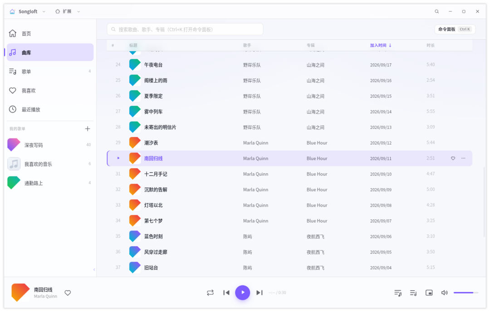
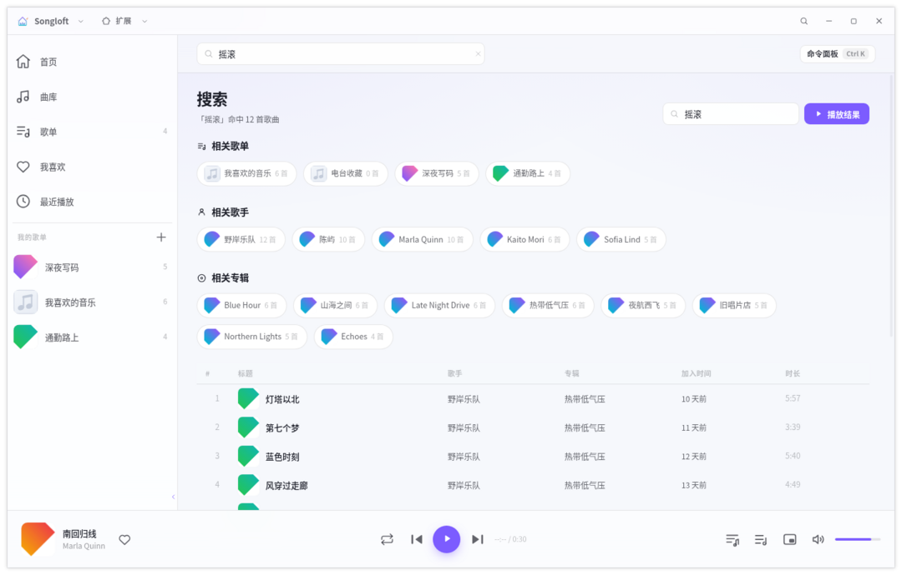
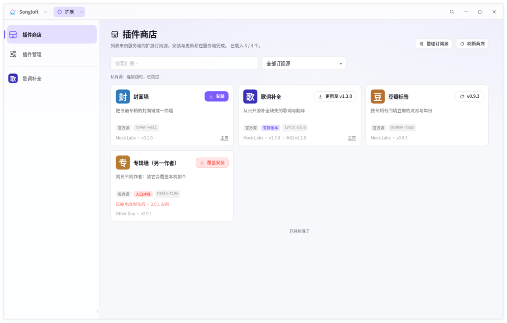
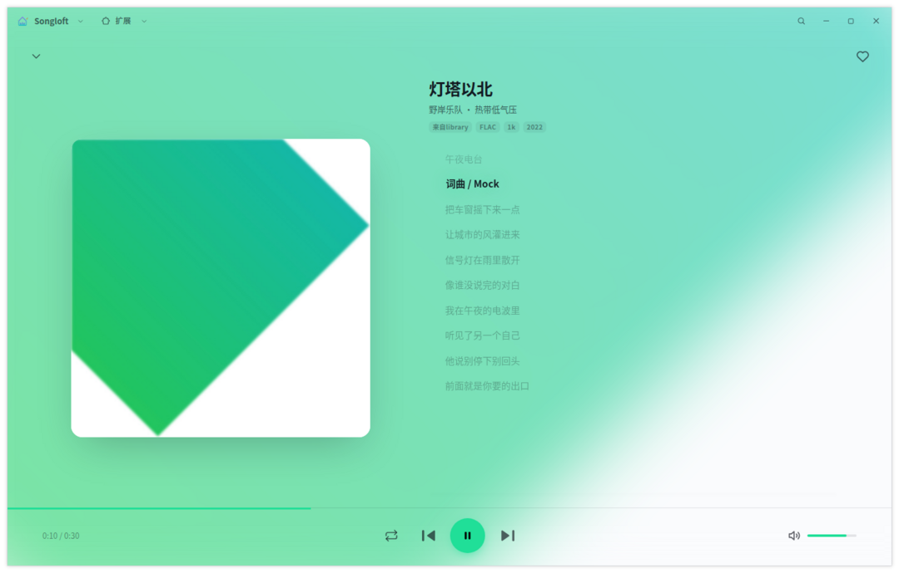
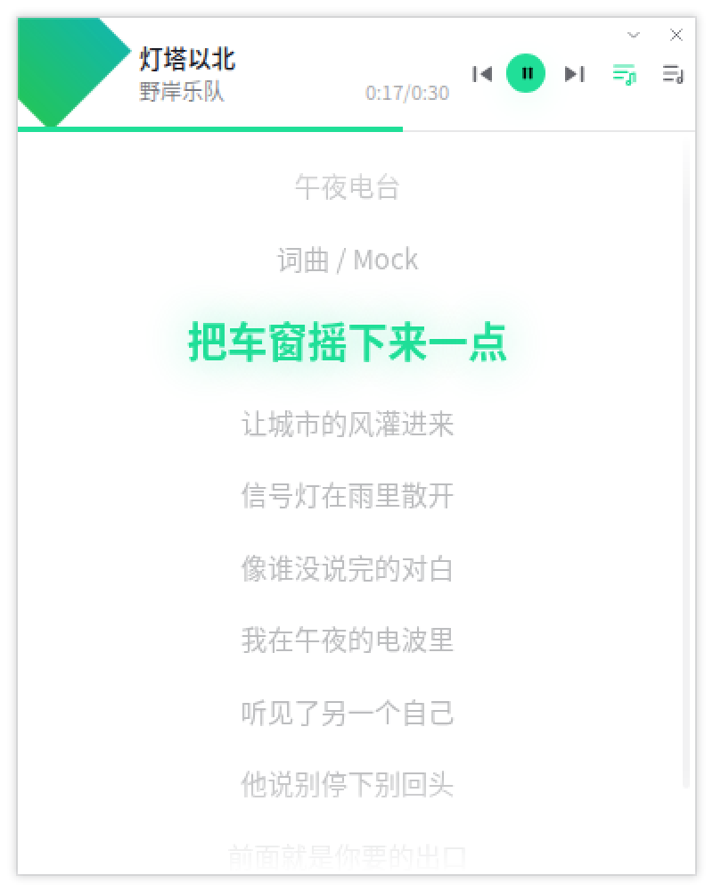
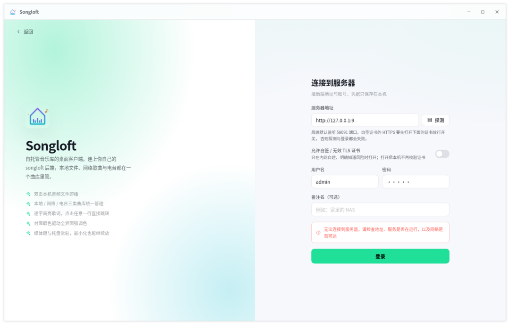

# Songloft Desktop

> 本仓库：<https://github.com/songloft-org/songloft-desktop>

[Songloft](https://github.com/songloft-org/songloft-player) 的 **Electron 桌面客户端**，
**Windows / macOS / Linux 三端均已提供安装包**（下载见
[Releases](https://github.com/songloft-org/songloft-desktop/releases)）。

Songloft 是「客户端 + 自建 Go 后端」的结构：后端管曲库、标签与转码，客户端只做展示与播放。
本仓库重写的是**客户端**，只做桌面三端（不含移动端与 Web 端），也**不含后端**
（后端见 [songloft-org/songloft](https://github.com/songloft-org/songloft)）。

> **为什么换成 Electron**：完整的选型论证（性能、体积、跨平台一致性、开发效率、生态与维护
> 成本，以及 vs Tauri / Wails / Qt / Avalonia / Compose Multiplatform / 全原生 等 10 条技术
> 路线的横向对比）见 [`docs/electron-migration-evaluation.md`](docs/electron-migration-evaluation.md)。

---

## 界面预览

> 下面这些图**不是手工截的**：`pnpm run e2e` 每次巡检都会把每个界面状态重拍一遍，
> `pnpm run shots` 再从那些截图里生成文档用图（含下面这些以及 [全部状态汇总图](docs/e2e-walkthrough.png)）。
> 改了界面就重跑这两条命令，别手工截图替换 —— 手工图会安静地过期。

| 曲库（表格 + 分面筛选） | 搜索 |
|---|---|
|  |  |
| **插件商店**（扩展面） | **满窗播放** |
|  |  |
| **迷你模式**（条下展开歌词） | **登录页**（服务器连不上时） |
|  |  |

其余界面的单张图在 [`docs/screenshots/`](docs/screenshots/)（首页 / 歌单 / 歌单详情 / 文件夹 /
多选与批量操作 / 歌曲右键菜单 / 设置 / 插件管理），**全部 74 个巡览状态**的一览见
[`docs/e2e-walkthrough.png`](docs/e2e-walkthrough.png)。

---

## 功能

### 曲库与检索

- 服务端分页 + 无限滚动；按类型（服务器 / 网络 / 电台）与歌手、专辑、流派、语种、风格分面筛选，7 种排序
- 关键词搜索；`Ctrl+K` 命令面板（命令 / 歌曲 / 歌单混合检索）
- 多选与批量操作（播放、入队、加入歌单、收藏、移除、删除），支持「全选当前筛选结果」
- 文件夹浏览：页头切到「服务器 → 文件夹」，按目录树逐层进入（面包屑可逐级跳回）
- 侧栏只有一个「曲库」入口：页头那颗**「本地 / 服务器」**切换在本机磁盘上的音频文件与
  服务端曲库之间换（前者见下面「本地文件」）；「服务器」那一格里还嵌着「曲库 / 文件夹」
  两颗子选项，而「分类浏览」「显示隐藏歌单曲目」是两颗图标钮，悬浮有提示

### 歌单与收藏

- 歌单创建 / 编辑 / 删除、封面、置顶、可见性；`position` 排序下可拖拽重排
- 把歌曲行直接拖到侧栏歌单即可加入
- 收藏与最近播放（本机记录，最多 200 条）

### 播放

- 播放 / 暂停 / 上一首 / 下一首；顺序、列表循环、单曲循环、随机四种模式
- 播放队列：任意来源入队、拖拽重排、双击跳转、清空；**跨重启恢复**（且不会自动出声）
  —— 这份记录只装曲库里的歌：本地文件的播放不会覆盖它（见下面「本地文件」）
- 原唱 / 伴奏音轨切换（后端提供多音轨时）
- 音量与静音、音质上限、后端响度归一化
- **满窗播放**：点底栏那颗封面把标题栏以下整块换成播放器（大封面 + 歌曲信息 + 歌词 + 控制条），
  左上角收起钮或 Esc 退出；底下的页面只是被盖住，退出后还是离开时那一页
- **迷你播放器**：一个**独立的小窗口**（主界面该干嘛干嘛），浮在屏幕一角、可置顶，
  条下面能展开歌词或播放队列
- **本地文件**：双击本机的音频文件就开始放 —— 那一趟**只起迷你播放器**（它就是播放器，
  主界面不打开）、不需要登录，播放列表也与在线歌单彼此无关；菜单或曲库页的「本地」那一半里
  挑文件时才走在主界面里（免登录）的那条路
- **系统媒体控件**：通过 Media Session 交给 Chromium 自动映射到 Linux 的 MPRIS、Windows 的
  SMTC、macOS 的 Now Playing，不需要为每个平台写原生桥；键盘媒体键另有兜底

### 歌词

- 四路歌词合并（主歌词 / 翻译 / 罗马音 / 逐字），逐字高亮，点击任意一行直接跳转过去
- 翻译与罗马音可单独开关，字号可调

### 扩展（JS 插件）

- 插件本体（manifest + 前端页面 + 沙箱里的 JS）全在**服务端**，客户端不存任何插件二进制
- **插件商店**：可订阅多个注册表源，卡片直接标出「可更新 / 已装 / 入口撞名」并能一键安装；
  「全部更新」只覆盖**声明了远程更新源**的插件
- **插件管理**：启用 / 停用、卸载、拖拽排序（决定扩展侧栏里的先后）、常驻运行、清理单个插件的数据
- 扩展在**独立的一面**里打开（左边扩展侧栏、右边插件自己的页面），与播放器互不干扰：
  插件页走单独的 session，所以宿主能单独静音它，也能在图标上看出它是不是正在出声

### 曲库维护

- 扫描（带进度与取消）、重新导入、音乐根目录与排除目录
- 清理失效歌曲、重复歌曲检测（音频指纹）

### 外观与桌面集成

- 亮色 / 暗色 / 跟随系统；强调色可**跟随封面取主色**做整页联动；界面密度、玻璃质感可调
- 无边框窗口 + 自绘标题栏（双击最大化）、窗口尺寸记忆、单实例运行（双击音频文件时会另起一个
  迷你播放器实例，那是刻意留的口子）
- 托盘菜单（当前曲目、播放控制、显示 / 隐藏窗口、退出），可选「关闭到托盘」；
  本地文件那一趟里没有「显示 / 隐藏窗口」这一项（迷你播放器就是全部界面，关掉它即退出）
- 多服务器管理与自签证书开关

---

## 快捷键

| 键 | 作用 |
|---|---|
| `Ctrl / Cmd + K` | 命令面板：搜歌曲、跳页面、控制播放 |
| `Ctrl / Cmd + ,` | 打开设置（走应用菜单的加速键 —— 窗口无边框、看不到菜单栏，键仍在） |
| `Ctrl / Cmd + F` | 聚焦到搜索框 |
| `空格` | 播放 / 暂停（输入框内不生效） |
| `Ctrl / Cmd + ← / →` | 上一首 / 下一首 |
| `↑ / ↓` | 音量增减 5% |
| `f` | 收藏 / 取消收藏当前曲目（输入框内不生效） |
| `Ctrl / Cmd + L` | 打开歌词面板，再按一次收起 |
| `Esc` | 收起满窗播放 |
| `Alt + ←` | 返回上一页 |
| 媒体键 / 托盘 | 键盘上的播放暂停、上一首、下一首键直接接管；最小化到托盘后仍能控制 |

设置里的「快捷键」一栏有同一份清单 —— 它是代码渲染出来的，以那里为准。

---

## 安装与运行

需要自建一个 Songloft 后端（默认 `http://localhost:58091`，默认管理员 `admin` / `admin`）。
**初次启动不要求登录**：直接进免登录模式，能放本机的音频文件；想连服务器就点侧栏那颗
「连接服务器」，在登录页填地址与账号（自签证书可在设置里单独放开），换主意按左上角那颗返回
即可退回。后端没起来时应用不会崩，登录页会给出可操作的提示。

安装包在 [Releases](https://github.com/songloft-org/songloft-desktop/releases) 里，三端各一份；
同一个 Release 还带 `SHA256SUMS.txt`，可用来校验下载到的文件：

| 平台 | 产物 | 说明 |
|---|---|---|
| Windows x64 | `.exe`（NSIS 安装包） | 可选安装目录；按**当前用户**安装，不弹 UAC；安装界面中文 / 英文；卸载时保留用户数据 |
| Windows x64 | `.zip`（免安装「绿色版」） | 解压即用，不写注册表、不装到系统目录。**配置与缓存就在解压目录的 `data\` 下** —— 整个文件夹拷到 U 盘（或另一台机器）就带走了全部配置。不注册文件关联，要让音频文件双击后用本应用打开，在「打开方式」里手动指一次 |
| macOS arm64 / x64 | `.dmg` / `.zip` | dmg 供人工安装，zip 给不便挂载 dmg 的场景。**未签名、未公证**，首次打开会被 Gatekeeper 拦下（见下） |
| Linux x64 | `.deb` / `AppImage` / `.tar.gz` | deb 适配 Debian / Ubuntu；AppImage 免安装、双击即用（已内置静态 runtime，不依赖 `libfuse2`）；tar.gz 解压即用 |

三平台的文件名是同一个式样：`Songloft-Desktop-<版本>-<系统>-<架构>.<扩展名>`，例如
`Songloft-Desktop-1.1.7-linux-x64.AppImage`、`Songloft-Desktop-1.1.7-windows-x64.exe`
（系统是 `windows` / `macos` / `linux`，架构是 `x64` / `arm64`）。同一个平台的多份产物按**扩展名**
区分：Windows 的 `.exe` 是安装包、`.zip` 是免安装绿色版。

### macOS：首次打开被 Gatekeeper 拦下

CI 里没有签名证书，所以 macOS 产物**未签名、未公证**：首次打开会被拦下（提示「已损坏」或
「无法验证开发者」），**这不是产物坏了**。任选一种方式放行，之后正常双击即可：

* 右键点图标 → 「打开」→ 在弹窗里再点一次「打开」；
* 或在终端执行 `xattr -dr com.apple.quarantine "/Applications/Songloft Desktop.app"`。

正式分发需要补签名与公证：填 `CSC_LINK` / `CSC_KEY_PASSWORD` secrets，并删掉
`release.yml` 里的 `CSC_IDENTITY_AUTO_DISCOVERY: 'false'`（细节见
[`electron-builder.yml`](electron-builder.yml) 的 `mac` 段）。

### 任务栏图标（Linux / GNOME）

GNOME（Wayland）画任务栏图标只认**宿主上**的 `.desktop` 条目：窗口自己声明的图标传不出去
（`xdg_toplevel` 协议里没有图标字段），GNOME 拿窗口上报的 app_id 去找同名条目，再用条目里的
`Icon=`（详见 [AGENTS.md](AGENTS.md) §8.11）。

* `.deb`：装好即生效。
* `AppImage` / `.tar.gz` / 开发态：都不往系统里装任何东西，所以**直接双击运行时任务栏里是一个
  占位齿轮** —— 这是 GNOME 的已知限制，不是产物坏了。要显示成应用图标，二选一：
  * 用 AppImageLauncher / Gear Lever 之类的集成工具接管这个 AppImage（产物里已经带了合规的
    条目与 hicolor 图标）；
  * 或者在本仓库里跑一次 `pnpm run desktop:install`（`bash scripts/desktop-integration.sh
    install /path/to/Songloft-Desktop-<版本>-linux-x64.AppImage` 可指向某个 AppImage；卸载用
    `pnpm run desktop:uninstall`）。它只写 `~/.local/share` 下两份文件，并把路径打出来。

**三端都没有自动更新**（也没接崩溃上报），升级需要手动下载新安装包替换。自行构建的方式见
[`docs/development.md`](docs/development.md)。

---

## 平台支持现状

Windows / macOS / Linux **三端都交付安装包**。三份产物由
[`.github/workflows/release.yml`](.github/workflows/release.yml) 在各自平台的 runner 上**并行构建**
（跨平台打包不可行：`pack:win` 要在 Windows 上跑，`pack:mac` 要在 macOS 上跑），三份全部成功
才创建 Release —— 任何一个平台失败都不会留下半份已发布的 Release。

| 平台 | 状态 | 已知欠缺 |
|---|---|---|
| Windows x64 | 出 NSIS 安装包 | 无代码签名（SmartScreen 会拦一次）；未做与 Linux 同等的产物级断言 |
| macOS arm64 / x64 | 出 dmg / zip | **未签名、未公证**；窗口控制钮仍是自绘、位于右上角（macOS 惯例是左上角）；未做产物级断言 |
| Linux x64 | 出 deb / AppImage / tar.gz | GNOME 下 AppImage / tar.gz 的任务栏图标需要额外集成（见上文）；`pnpm run verify:package` 只覆盖 Linux 产物 |

「产物级断言」指 [`scripts/verify-package.sh`](scripts/verify-package.sh) 那一套：解包产物后断言
桌面条目、图标、AppArmor profile 真的在包里。Windows / macOS 目前只由 CI 断言产物**存在**
（`.exe` / `.dmg` 等一个不缺），没有同等深度的检查。

---

## 与上游 Flutter 版的差异

### 已对齐

曲库浏览（类型 / 分面 / 排序 / 无限滚动）、歌单增删改与拖拽重排、收藏、最近播放、文件夹浏览、
逐字歌词与点击跳转、播放队列、命令面板、扫描与重复检测、设置项、亮暗主题、多服务器与令牌管理、
JS 插件（扩展）的安装 / 启停 / 卸载 / 排序 / 本地包上传 / 批量更新 / 单个插件更新 /
常驻运行 / 残留数据清理，以及插件商店的订阅源管理与按源筛选。

**插件系统的形态差异**：插件装在服务端、页面由服务端提供，客户端只做「入口 + 装载」。
上游把插件挂在底部导航栏的 Tab 上；本端没有底部导航栏，改成**标题栏左上角一个「扩展」入口**
（图标 + 文字 + 一颗下拉三角，三角里从上到下是「插件商店 / 插件管理」、一条分割线、以及所有
已开启的扩展 —— 扩展项点一下直接进去，管理动作都在「插件管理」那一栏），点主操作把标题栏
以下整块换成扩展主框架：左侧栏固定「插件商店 / 插件管理」两条入口、
中间列出已安装的扩展、右下角一颗收起按钮（浮在列表上，不占一行；这条侧栏在插件管理页可以
设成展开 / 折叠 / 隐藏），右侧那一栏在商店 / 管理 / 某个扩展的页面之间切换。宿主用
`<webview>` 装载插件页，因此**插件自带的界面一行都不用重写**。紧挨着它的「Songloft」也是一颗
拆分按钮：左边回到原生的那一面，右边的下拉是原来的导航菜单（首页 / 曲库 / 歌单 / 我喜欢 /
最近 / 设置）。

**两面都在 DOM 里，来回切时各自保持离开时的样子**：原生面停在哪个页面、滚到哪儿、列表加载了
多少，扩展面在商店的第几页、筛的是哪个订阅源、正在放哪个扩展 —— 切走再切回来都是原样
（正在出声的扩展也继续出声，不会因为切去曲库就被关掉）。

### 尚未实现

| 能力 | 说明 |
|---|---|
| 插件系统 | 商店里标着「有新版本」的条目只能逐个装 —— 后端的批量更新（「全部更新」）只覆盖**声明了远程更新源**的插件 |
| 均衡器 | 上游直接给 libmpv 设音频滤镜；本端可用 Web Audio 的 `BiquadFilterNode` 实现 |
| 无缝播放 / 淡入淡出 | 上游由 mpv 提供；`HTMLAudioElement` 不原生支持 gapless |
| 桌面歌词悬浮窗 | 上游约 690 行 |
| Bundle 本地模式 | 上游可内嵌 Go 后端（桌面端以子进程拉起 `songloft-server`），免服务器、启动即自动登录。**本端只支持连接远程后端** |
| 歌曲元数据编辑、手动指定歌词、添加网络歌曲 | 后端端点已写进客户端，界面入口尚未做 |
| 登录令牌管理 | 列出与吊销的端点已经写在 `src/renderer/src/api/endpoints.ts` 里，设置页没有入口（也就看不到「这台机器的那枚令牌」，要踢掉它得去后端） |
| 自动更新 / 崩溃上报 | 上游设置里有「升级」入口；本端升级需手动替换安装包，也没有崩溃上报 |
| 多语言界面 | 上游有中 / 英 / 西三语（约 22,941 行本地化产物），本端界面目前只有中文 |

### 工程与实现上的差异

| 维度 | 上游 Flutter 版 | 本版本 |
|---|---|---|
| 交付平台 | 六端（含移动端与 Web） | 只做桌面三平台（Windows / macOS / Linux），三端均已提供安装包 |
| 音频链路 | 横跨 8 个包 + libmpv 原生库 + 每平台一套系统媒体桥 | `HTMLAudioElement` + Media Session，解码在 Chromium 内部 |
| 界面渲染 | 自带 Skia / Impeller | 自带 Chromium，三平台同一渲染引擎 |
| 安装体积 | deb 声明安装体积 100 MB | 实测安装后 284 MB、deb 95.4 MiB、AppImage 111.8 MiB —— 约 2.8 倍；内存仍是明显劣势 |
| 插件宿主 | Dart 宿主跑 JS 插件（服务端 QuickJS 沙箱），需要跨语言桥 | 插件页面直接以 `webview` 装进窗口，宿主与插件页之间没有语言边界；沙箱仍在服务端 |

体积与内存的实测口径见 [`docs/electron-migration-evaluation.md`](docs/electron-migration-evaluation.md) 第 3.1 节。

---

## 文档索引

| 文档 | 内容 |
|---|---|
| [`docs/development.md`](docs/development.md) | 开发指南：环境要求、命令、目录结构、架构、安全模型、打包要点、测试 |
| [`AGENTS.md`](AGENTS.md) | 面向 AI 编码代理的项目说明（架构地图、约定、雷区） |
| [`docs/electron-migration-evaluation.md`](docs/electron-migration-evaluation.md) | 换栈评估报告：10 条技术路线的横向对比与结论 |
| [`NOTICE`](NOTICE) | 随产物分发的第三方组件署名与编解码器许可说明 |
| [`docs/screenshots/`](docs/screenshots/) | 主要界面的截图（由巡检产物生成，见 [`scripts/e2e/shots.sh`](scripts/e2e/shots.sh)） |
| [`docs/e2e-walkthrough.png`](docs/e2e-walkthrough.png) | 端到端巡检覆盖的 **74 个界面状态**一览（一格一步，带步骤名） |

---

## 许可

Apache-2.0，正文见 [`LICENSE`](LICENSE)。上游
[songloft-player](https://github.com/songloft-org/songloft-player) 亦为 Apache-2.0。
随产物分发的第三方组件、以及 Chromium 内置编解码器需要自行确认的许可事项，见 [`NOTICE`](NOTICE)。
